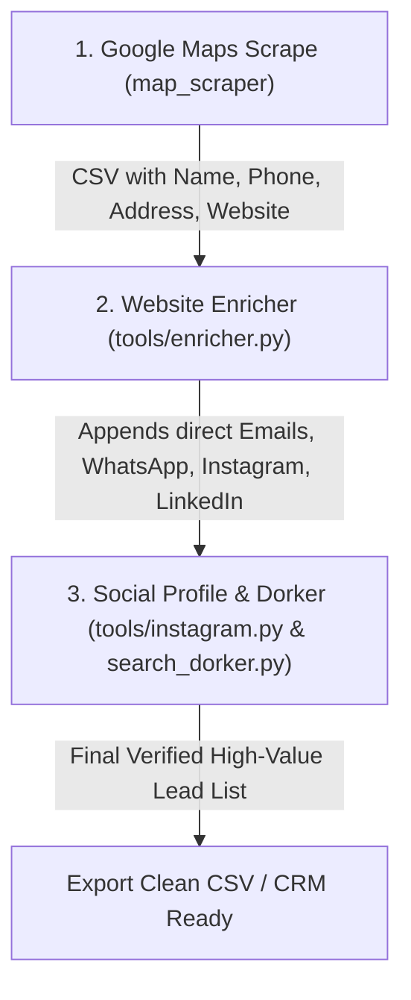

# Modular Lead Generation & OSINT Tools Suite

This directory contains standalone, legally compliant, and ban-free scraping and lead enrichment tools designed to complement `map_scraper` and the `my_app` desktop application.

---

## Tool Catalog

| Tool | File | Purpose | Anti-Ban / Legal Strategy |
| :--- | :--- | :--- | :--- |
| **Google Maps** | `map_scraper/` | Local business search, ratings, reviews, phones, addresses | Local Chrome CDP stealth; zero API keys |
| **Website Enricher** | `tools/enricher.py` | Extracts verified emails, WhatsApp, and social profile URLs from business websites or CSV files | Crawls public websites directly — 100% legal, zero account ban risk |
| **Instagram Inspector** | `tools/instagram.py` | Bio, follower counts, verified badges, external links | 100% anonymous public metadata extraction (never logs in with accounts) |
| **B2B Search Dorker** | `tools/search_dorker.py` | Discovers LinkedIn company pages, founders, and decision-makers | Uses public search indexers (DuckDuckGo) outside LinkedIn login gates |
| **Social Finder** | `tools/social_finder.py` | Multi-platform username and brand presence scanner | Direct public HTTP presence verification across 8+ platforms |

---

## Installation & Setup Plan

### Step 1: Prerequisites
All tools run on standard Python 3.9+ with `requests` and `beautifulsoup4`.

```bash
# Verify Python version
python --version

# Install core dependencies (already present in most environments)
pip install -r tools/requirements.txt
```

### Step 2: Running Tools via the Central Dispatcher (`tools.py`)
You can invoke any tool from the repository root:

```bash
# List all registered tools and their readiness
python tools.py list

# 1. Enrich a single business website:
python tools.py run enricher --url "https://abcoffee.in"

# 2. Enrich an entire Google Maps scraped CSV file:
python tools.py run enricher --csv map_scraper/thane_female_dress_shops.csv

# 3. Inspect public Instagram profile anonymously:
python tools.py run instagram "blue_tokai"

# 4. Search Dorker for LinkedIn company profile and founders:
python tools.py run dorker --company "Blue Tokai Coffee" --city "Mumbai"

# 5. Check brand presence across all social media platforms:
python tools.py run social_finder "bluetokaicoffee"
```

---

## 3-Step Lead Generation Workflow


